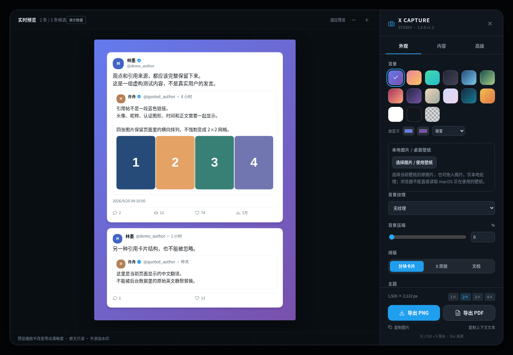

# X Capture Studio

本地优先的 X / Twitter 高保真内容保存工具，同时提供：

- **Chromium 浏览器扩展**：Chrome / Edge 等 Chromium 浏览器。
- **Stay Userscript**：用于 iPhone / iPad 的 **Safari + Stay**。

核心目标不是媒体下载，而是把 Tweet、Thread、Article 以及用户选中的回复上下文，以接近 X 原始浏览外观的方式保存为高清长图或保留真实文字的 PDF。



## 当前推荐版本

| 平台 | 推荐版本 | 状态 |
|---|---:|---|
| Chromium 浏览器扩展 | **1.0.0-rc.2** | 已在本地集成测试并经实际桌面使用反馈确认可用 |
| Safari + Stay userscript | **1.0.0-rc.3** | Stay 注入方式修订版，并经实际 Safari + Stay 使用反馈确认入口正常 |

> `main` 保留共享源码；两个安装端目前使用不同候选版本号，因为 rc.3 只针对 Stay 注入兼容性进行了专项修订。

## 主要能力

- Single / Thread / Select 内容选择。
- 可把非贴主回复作为上下文纳入，并逐条手动勾选。
- 分块卡片、接近 X 原貌、文档三种布局。
- 参数化背景、渐变、透明、自定义图片 / 壁纸背景。
- PNG 默认单张长图，支持 1× / 2× / 3× / 4× 输出倍率。
- PDF 默认单张长页，正文保持真实文本，可选择、复制、搜索。
- PNG / PDF 内保存原帖来源链接；PDF 中可点击。
- Quote Post、长文、Article、图片与视频封面按展示型内容处理。
- 本地处理，无强制水印。

## 安装

### Chromium

下载并解压：

```text
releases/X-Capture-Studio-Chrome-v1.0.0-rc.2.zip
```

1. 打开 `chrome://extensions`。
2. 开启「开发者模式」。
3. 选择「加载已解压的扩展程序」。
4. 选择解压后直接包含 `manifest.json` 的目录。
5. 刷新 X 页面。

### Safari + Stay

导入：

```text
releases/X-Capture-Studio-Stay-v1.0.0-rc.3.user.js
```

在 Stay 中启用脚本并允许其访问 X / Twitter，然后回到 Safari 完整刷新 X 页面。

## 开发

要求 Node.js 20+。

```bash
npm install
npm run typecheck
npm run build
npm test
```

构建输出：

- `dist/extension`
- `dist/X-Capture-Studio.user.js`
- `dist/X-Capture-Studio-Demo.html`

## 项目结构

```text
src/                  共享解析、选择、布局、UI、导出与平台适配
assets/               Manifest、HTML、Stay bootstrap、图标
vendor/               固定版本第三方 JS 引擎及许可证
scripts/              构建与测试脚本
tests/                单元、契约、浏览器与 Stay 启动测试
docs/                 决策、隐私、验证、变更记录
releases/             当前确认可用的 Chromium / Stay 安装文件
tools/                可选辅助工具
```

## 版本与验证说明

- 浏览器端当前保留 **rc.2** 作为推荐安装版。
- Stay 当前推荐 **rc.3**；它移除了会让 Stay 进入 page injection 的 `unsafeWindow` 依赖，并对 Stay 的公开注入实现做了兼容处理。
- X 是动态页面，DOM 结构发生变化时可能需要更新适配器。
- 本项目不会把“当前已加载回复”宣称为 X 上的完整评论集合。

详见：

- [`docs/CHANGELOG.md`](docs/CHANGELOG.md)
- [`docs/VERIFY_STAY_RC3.md`](docs/VERIFY_STAY_RC3.md)
- [`docs/PRIVACY.md`](docs/PRIVACY.md)
- [`docs/RELEASE_MATRIX.md`](docs/RELEASE_MATRIX.md)

## License

当前仓库尚未指定项目自身的开源许可证。第三方依赖许可证见 `vendor/THIRD_PARTY_NOTICES.md`。
